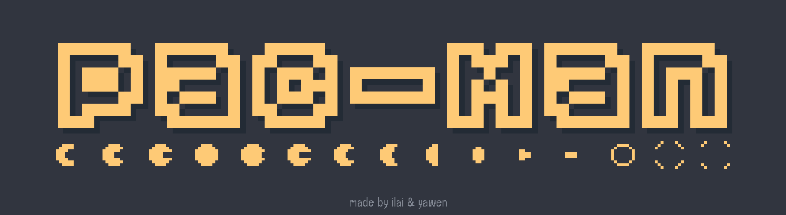

*This project has been created as part of the 42 curriculum by yafu, ivan-der.*



## Description
A **Pac-Man** remake, built in Python using `pygame-ce`. The main goal of this project is to create dynamic game states, ghost behavior/pathfinding, 
real-time input handling, and automated maze parsing within a modular, maintainable architecture.

Key features include:
- Dynamic ghost states based on player actions.
- Procedural/dynamic level generation and scaling via the given `mazegenerator` package.
- Highscore tracking, custom settings configuration, and level management.
- Cheat menu allowing for easier debugging of game behaviors.

---

## Instructions

### Prerequisites
- Python `3.12+`
- Package manager: [`uv`](https://github.com/astral-sh/uv)

### Instructions
1. **Clone the repository:**
   ```bash
   git clone https://github.com/Ilaivdv/codam-pacman.git
   cd codam-pacman
   ```

2. **Install dependencies:**
   ```bash
   make install
   # Or
   uv sync
   ```

3. **Run the game:**
   ```bash
   make
   # Or
   uv run pac-man.py
   ```

   **Build to standalone executable:**
   ```bash
   make build
   ```

---

## Configuration

The project reads settings from `config.json`. If the file is missing or invalid, standard default values are automatically generated and applied.

### Configuration(default)
```json
  {
    'highscore_filename': "highscore.json",
    'level': 10,
    'width': 15,
    'height': 15,
    'lives': 3, 'pacgum': 42,
    'points_per_pacgum': 10,
    'points_per_super_pacgum': 50,
    'points_per_ghost': 200,
    'seed': 42,
    'level_max_time': 90
  }
```

---

## Highscore

### Implementation Details
The highscore system reads and writes scores to a local persistent file (`~/.local/share/highscore.json`). Scores are updated immediately upon game completion or failure. In the game, only top 10 records are displayed.

### Design Choice
We chose an explicit file-backed JSON over in-memory storage to ensure data retains integrity across sessions without requiring external database dependencies. If the file doesn't exist, the program will create one empty file.

---

## Maze Generation

This project integrates the `A-Maze-ing` maze generation package made by 42.

- **Parsing & Visuals:** The output grid array from `mazegenerator-2.0.2-py3-none-any` is mapped dynamically to grid coordinates, scaling pacgums, walls, and spawn points based on window boundaries.
- **Pathfinding Graph:** Grid nodes are converted into an adjacency matrix/node graph used by the ghost pathfinding algorithm (A* search).

---

## Implementation

The general approach for the implementation was based on conventions and systems commonly used in real-world game development.
After looking into and learning from other game engines and how they implement game loops, the end approach ended up being a similar one to that of the Godot game engine 
and it's Node based tree structure.
Throughout the entire development of this project, one of the top priorities was ensuring everything stayed modular and as easy to change as possible.

---

## General Software Architecture

To make the game as dynamic as possible, we opted for a process tree structure containing a list of objects all inheriting from our `GameObject` class ensuring base functionality needed for all objects in the game.
With this approach, it made the program extremely easy to work with as when one of us needed to add any new features, we simply make a new class inheriting from `GameObject` 
and add and remove it from the process tree whenever needed also avoiding any conflicts while working on the game at the same time.

This type of reusibility and adaptability was kept as a priority when implementing any new additions like the UI and *entities*. 
The `Entity` class in our game is like a template used for all objects requiring movement, collision and special player interactions. 
Objects inheriting from `Entity` are the player, ghosts and consumables like pacgums and super pacgums, it holds all needed logic for movement, collision and rendering.

Here is a look at our games structure:
```text
src/
├── docs/                        # Project management documentations
      └──process_track.md        # Github issues log
      └──team_organization.md    # Explanation of Teamwork
├── level/                       # Everything needed for gameplay
      └── entities/              # Holds player, ghosts and consumables as well as entity template
├── ui/                          # UI elements, clickable, non-clickable
    ├── overlay/                 # UI interface that overlay on current screen
    └── screens/                 # UI interface that occupies the whole screen
└── utils/                       # General utilities used around the whole module
    ├── sprite_sheet.py          # Holding sprites rendered and handles the animation player
    ├── state.py                 # Template used for states to seperate behavior states
    ├── game_object.py           # Main template used for every element game has to render
    └── ...
```

---

## Project Management

This project was developed iteratively using GitHub Projects:
- **Task Tracking & Roadmap:** Tasks were organized into feature branches, code reviews, and issue tracking.
- **Documentation:** Project process track ['process_track.md'] are extracted from all the issues we created on github. And a ['team_organization.md'] to explain how we work as a team.

---

## Resources & AI Disclosure

### References
- [Pygame Documentation](https://pyg.am/docs/)
- [The Pac-Man Dossier (Jamey Pittman)](https://pacman.holenet.info/)
- [Creating Start Menu in Pygame](https://www.geeksforgeeks.org/python/creating-start-menu-in-pygame/)
- [Pygame tutorial](https://www.geeksforgeeks.org/python/pygame-tutorial/)

### AI Usage Disclosure
In accordance with 42 curriculum guidelines, AI assistance was utilized for documentation.
